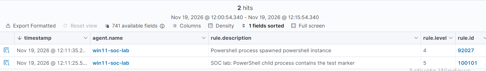

# Wazuh SOC Home Lab

I built a Windows endpoint monitoring lab in VMware Workstation to practice alert triage, event correlation, and detection testing. The lab uses a Wazuh server and a Windows 11 VM enrolled as `win11-soc-lab` (agent `001`). Both VMs use the VMnet19 NAT network.

**Data flow:** Windows Application, Security, and Sysmon Operational logs → Wazuh agent → Wazuh manager and indexer → Threat Hunting dashboard.

## Investigations

| Case | Evidence | Finding |
|---|---|---|
| Software installation | Application event `1033`, rule `60612`, level 3 | The recorded product and version matched my Wazuh Agent 4.14.10 installation. |
| Failed then successful sign-in | Security events `4625` and `4624`, rules `60122` and `60118` | I matched the endpoint, target account, and interactive logon type. The successful sign-in followed the incorrect-password attempt by 4.995 seconds. |
| Local Administrators group change | Security events `4732` and `4733` | The member SID matched across both records, confirming that the same disabled test account was added and removed. |
| PowerShell process creation | Sysmon event `1`, rule `92027`, level 4 | The command line contained my test marker, confirming that the process creation event reached Wazuh. |

## Custom detection and validation

I built a child rule that builds on rule `92027` and checks the PowerShell command line for a controlled test marker.

```xml
<group name="local,windows,sysmon,">
  <rule id="100101" level="5">
    <if_sid>92027</if_sid>
    <field name="win.eventdata.commandLine" type="pcre2">\bWAZUH-SOC-CUSTOM-TEST\b</field>
    <description>SOC lab: PowerShell child process contains the test marker</description>
  </rule>
</group>
```

I added the rule to `/var/ossec/etc/rules/local_rules.xml`, checked the ruleset with `sudo /var/ossec/bin/wazuh-analysisd -t`, and restarted the manager. From PowerShell in the Windows VM, I ran:

```powershell
powershell.exe -NoProfile -Command "Write-Output 'WAZUH-SOC-CUSTOM-TEST'"
powershell.exe -NoProfile -Command "Write-Output 'WAZUH-SOC-CONTROL'"
```

| Input | Observed rule | Interpretation |
|---|---|---|
| `WAZUH-SOC-CUSTOM-TEST` | `100101`, level 5 | The custom rule matched the marker. |
| `WAZUH-SOC-CONTROL` | `92027`, level 4 | The control matched the built-in PowerShell rule. |

Dashboard query:

```text
agent.id:"001" AND (rule.id:"100101" OR rule.id:"92027")
```

This rule validates the detection pipeline with a lab marker. In an investigation, I would review the parent process, command line, account, and surrounding events before deciding whether to escalate.

## Troubleshooting

After moving both VMs to VMnet19, I restored dashboard access by starting the failed indexer and manager services. I then updated the existing Windows agent to use the manager's new address and verified that agent `001` returned to Active.

## Evidence

The screenshots follow the investigation order: agent status (01), software installation (02), failed and successful sign-ins (03–04), Administrators group changes (05), Sysmon process creation (06), and custom rule validation (07).

